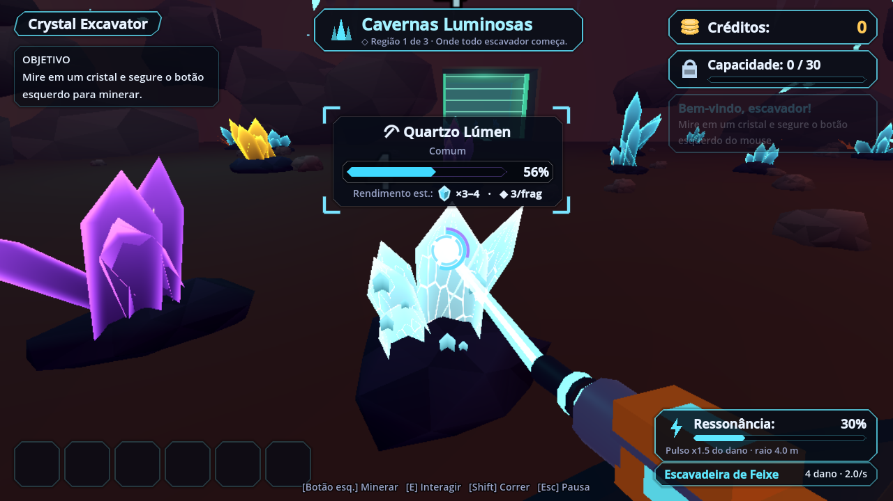

# Crystal Excavator

Jogo incremental 3D em primeira pessoa: explore cavernas luminosas, minere formações de cristal,
venda os fragmentos, melhore suas ferramentas e desça até o Núcleo Ancestral.

Feito em **Godot 4.5.1 (.NET) com C#**. Todo o conteúdo visual e sonoro é gerado proceduralmente em código.



## Como jogar

| Ação | Controle |
|---|---|
| Mover | W A S D (ou setas) |
| Olhar | Mouse |
| Minerar | Segurar o botão esquerdo |
| Interagir (venda, loja, portões) | E |
| Correr | Shift |
| Pular | Espaço |
| Pausa / fechar janelas | Esc |
| Salvar rapidamente | F5 |
| Mostrar FPS | F3 |

**Ciclo de jogo:** minere cristais → os fragmentos são atraídos até você → venda na **Estação de Venda** (verde)
→ compre melhorias no **Terminal** (dourado) → desbloqueie novas regiões nos **portões** de energia.

**Ressonância:** golpes em ritmo constante carregam o arco violeta da mira. Quando ele fica dourado,
o próximo golpe libera um pulso que atinge todos os cristais próximos.

### Regiões
1. **Cavernas Luminosas**: Quartzo Lúmen, Ametista Cintilante e a rara Lágrima Solar.
2. **Profundezas Prismáticas** (◈ 6.000): névoa gelada, Safira, Esmeralda e o raro Prisma Estelar.
3. **Núcleo Ancestral** (◈ 400.000): ruínas rúnicas, brasas douradas, Rubi, Ancestralita, a rara Pérola do Vazio e a formação especial **Coração Ancestral**.
4. **Reservatório Abissal** (região bônus, ◈ 1,5 mi): lago luminoso e águas-vivas, Cristal de Maré, Coral Prismático e a lendária Lágrima Abissal.

Cada região tem um **evento ambiental** periódico (Eco Luminoso, Maré Gélida, Surto do Núcleo, Maré Luminosa).
Os materiais têm **raridade** (Comum, Incomum, Raro, Épico, Lendário), e a ferramenta evolui por **6 modelos**
(Broca Inicial → Quebra-Núcleo) conforme a Potência do Feixe.

## Executar no Windows (build pronta)
1. Copie a pasta `build/windows/` inteira. O `.exe` precisa da pasta `data_CrystalExcavator_windows_x86_64` e do `.pck` ao lado.
2. Execute `CrystalExcavator.exe`. Não é preciso instalar .NET; o runtime vai junto.
3. Se o Windows SmartScreen avisar sobre um aplicativo desconhecido, clique em **Mais informações → Executar assim mesmo** (o executável não é assinado).
4. Para depurar, use `CrystalExcavator.console.exe`, que abre um console com os logs.

**Desempenho:** na primeira execução, GPUs Intel HD/UHD recebem automaticamente a qualidade **Baixa** e escala 3D de 85%.
Ajuste em *Configurações* (qualidade, escala 3D, limite de FPS, VSync). Para máquinas modestas recomendamos
720p, qualidade Baixa e limite de 60 FPS.

**Saves e configurações:** `%APPDATA%\CrystalExcavator\` (`save.json`, `save.json.bak`, `settings.json`).
O jogo salva automaticamente a cada 45 s, após vendas e desbloqueios e ao sair.

## Abrir o projeto (desenvolvimento)
Requisitos: **Godot 4.5.1 .NET** (versão "Mono/.NET" do site oficial) e **.NET SDK 8**. VS Code é opcional (extensão C#).

1. Abra o Godot .NET → *Importar* → selecione `project.godot`.
2. Pressione **F5** para jogar.
3. Para editar o código no VS Code, abra a pasta do projeto (há `CrystalExcavator.sln`).

### Linha de comando
```bash
dotnet build                                   # compila o C#
godot --headless --path . -- --run-tests       # 156 verificações automatizadas
godot --headless --fixed-fps 60 --path . -- --bot=120   # bot que joga a partida completa
godot --path . -- --shots=C:/pasta/saida       # tour de capturas de tela + FPS
godot --headless --path . --export-release "Windows Desktop" build/windows/CrystalExcavator.exe
```
Os modelos de exportação do Godot 4.5.1 .NET precisam estar instalados (*Editor → Gerenciar modelos de exportação*).

## Estrutura
Veja [`PROJECT_STATE.md`](PROJECT_STATE.md) para a arquitetura completa e [`DEVELOPMENT_LOG.md`](DEVELOPMENT_LOG.md) para o histórico.

## Créditos e licenças
- Código, malhas, materiais, efeitos, sons e música: originais, gerados por código neste projeto.
- Motor: [Godot Engine](https://godotengine.org) (licença MIT). Fonte padrão do Godot, distribuída com o motor sob a licença dele.
- Nenhum asset externo é utilizado.
